<p align="center">
  
</p>

<h1 align="center">ComfyUI-Danbooru-Anima-Prompt</h1>

<p align="center"><a href="README.md">中文</a></p>

<p align="center">This plugin runs in ComfyUI. Its custom nodes output prompts in the format and order that mainstream anime models expect. It also includes tools for managing generated images and for writing prompts. Hope you like it.</p>

<p align="center">
  <a href="https://icn01wg02kz3.feishu.cn/wiki/GM2jwW1ocic6cskuctScVY1wn77?from=from_copylink" target="_blank" rel="noopener noreferrer">Detailed node tutorial (Chinese)</a>
</p>

<p align="center">
  <a href="#prompt-authoring">Prompt authoring</a> ·
  <a href="#search-and-tags">Search and tags</a> ·
  <a href="#editing-prompts">Editing prompts</a> ·
  <a href="#generated-images">Generated images</a> ·
  <a href="#top-bar-settings">Top-bar settings</a> ·
  <a href="#resolution-and-groups">Resolution and groups</a>
</p>

<p align="center">
  Building this plugin took a lot of time and effort. If you like it, a follow on my Bilibili account helps. Follows and likes are the best encouragement.<br>
  <a href="https://space.bilibili.com/169318349" target="_blank" rel="noopener noreferrer"> Bilibili</a>
</p>

## Prompt authoring

### Prompt Composer

Pick tags yourself, then choose one of three modes, Anima, Noob, or Aesthetic, and get the prompt format for that mode.

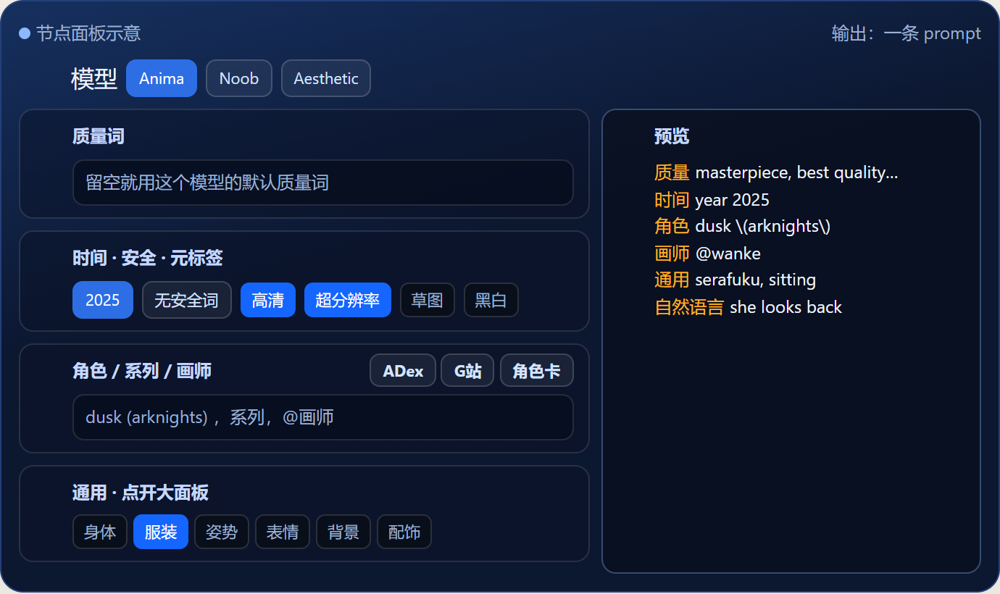

### NewBie Prompt Composer

Similar to Prompt Composer, built for the NewBie model's XML prompts. It outputs prompts in the XML format the NewBie model expects.

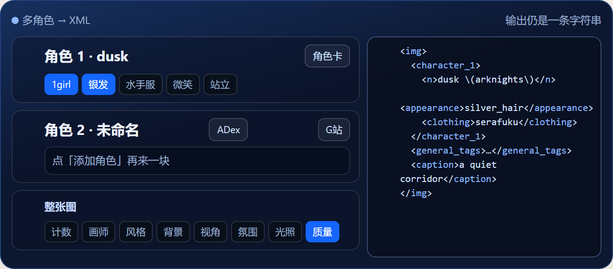

### Random Prompt

Draws a random prompt.

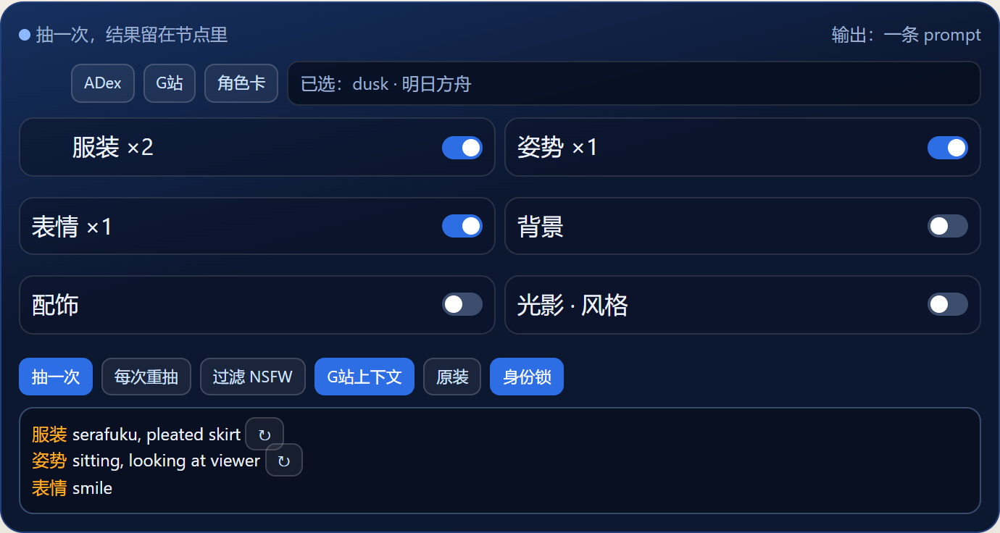

### Prompt Combiner

Use it with the Danbooru Browser and the Gelbooru Browser. It takes the tags they output, then writes a prompt in the format of the mode you selected. You can also connect the Tag Classifier and turn locally tagged results into that same format.

### Artist Picker

The node is named 画师选择 in the Chinese UI. It is for picking and combining artists. Add artists you use often along the bottom. They can come from favorites in the Danbooru node, or from artists and favorites in the AnimaDex node. After you pick one, it goes into the output strip.

Artists in the output strip can be dragged to change their order. That order is the order of the artist tags in the output.

It also accepts an artist string in one step, and it can manage saved artist strings.

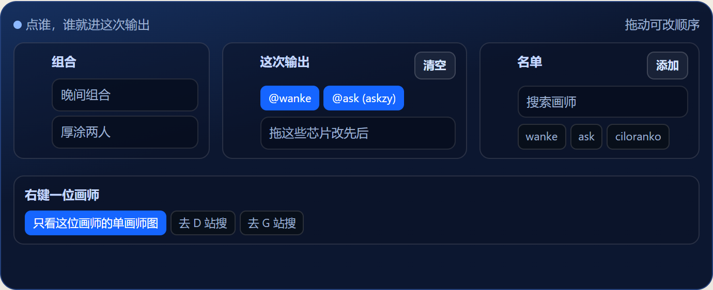

## Search and tags

### Danbooru Browser

Inspired by [Danbooru Gallery](https://github.com/Aaalice233/ComfyUI-Danbooru-Gallery), with a lot of extra behavior for daily use. The UI is much improved over the early version, and there are many more functions. It can favorite images and tags. Artist tags saved here can be used in Artist Picker. Favorite images can be categorized and filtered.

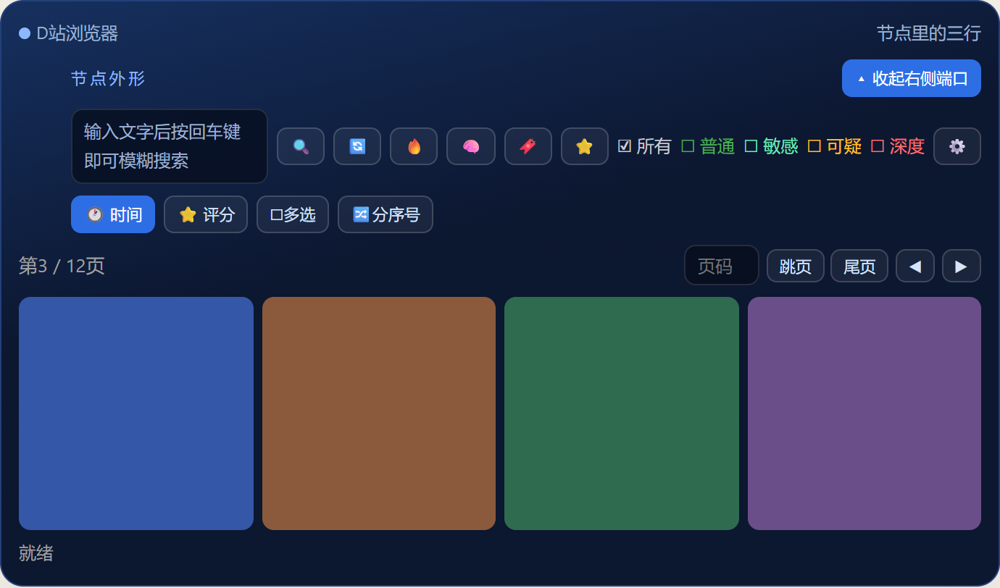

### Gelbooru Browser

The Gelbooru version of the Danbooru Browser. The functions match.

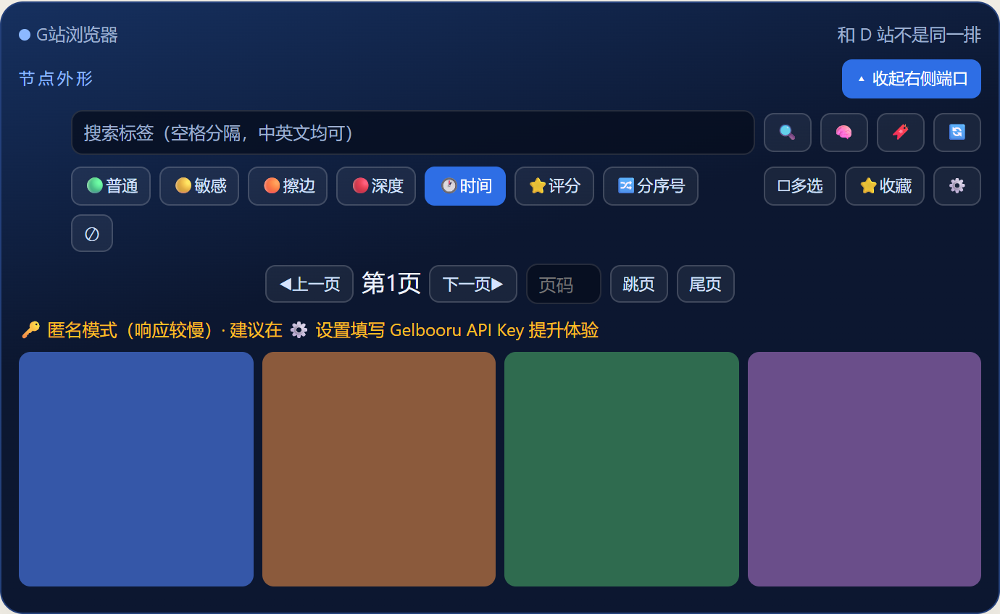

### AnimaDex Browser

Uses AnimaDex's own artist and character data while you write prompts. It can also work together with the Danbooru Browser or the Gelbooru Browser.


### Tag Classifier

Usually used to sort tags that came from a local tagger. Connect the sorted result to Prompt Combiner to get a prompt in the mode you selected.

### Tag Mapper

For tags that were not classified yet. You sort them by hand and save. The next time the Tag Classifier sees the same tag, it puts that tag in the category you saved.

## Editing prompts

### Text (passthrough)

A relay for prompt text.

When input mode and pause mode are both on, text coming in from the previous node stops here, and a "确认输出" (Confirm output) button appears. You have to click that button before the text is sent on. That is the usual way to use this node. It can also be a place to write the prompt yourself: switch the input mode to content mode.

In content mode the node ignores whatever came in, and outputs the text written in the node.

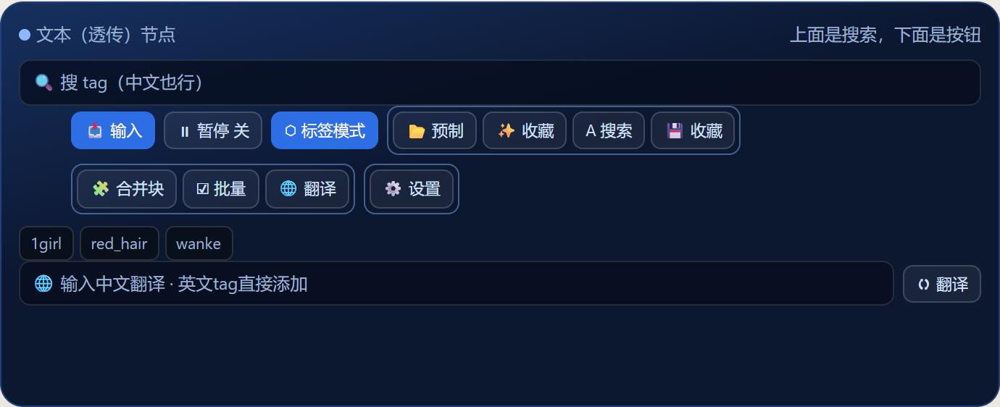

### Text (fuzzy search)

Like Text (passthrough) in content mode, without the pause.

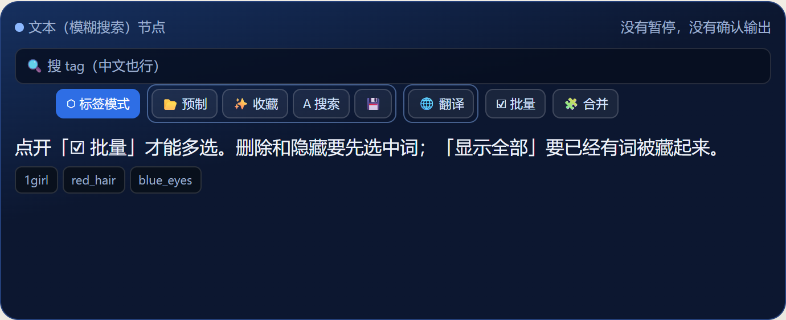

### Text

Same as other text nodes. Write a piece of text, and it is output as written.

### Text Concat

Joins several pieces of text. Several separators are available.

### Tag preview

A preview node meant for looking at tags.

### Tag dedupe

If the same tag appears more than once in one line, only the first one is kept.

## Generated images

### Output prompt viewer

Like the plugin settings, it sits on the ComfyUI top bar. The icon looks like this: . It manages images made from tagged prompts. Right-click an image to save that image's artist combination. Saved combinations can be managed in Artist Picker.

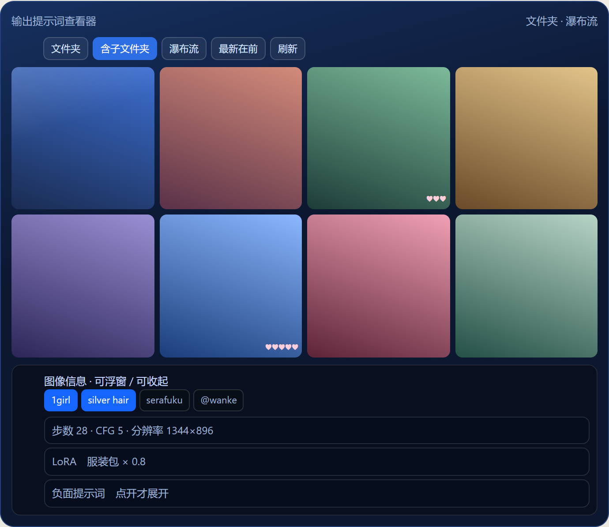

## Top-bar settings

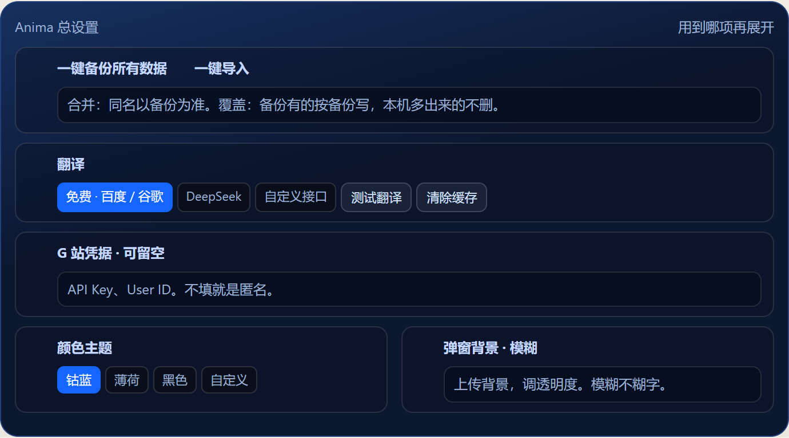

## Resolution and groups

### Anima Resolution Selector

Pick the width and height for the image, and connect it to Empty Latent Image.

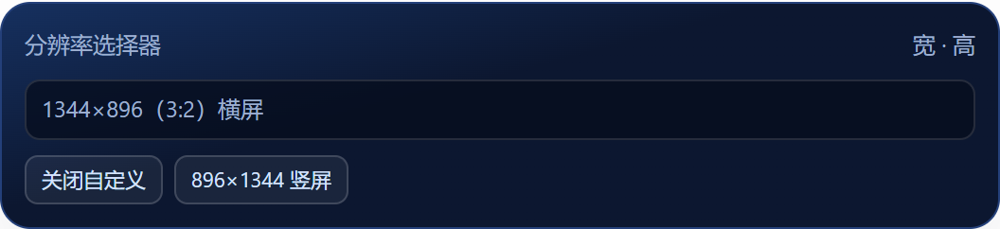

### Anima: Scale by Aspect Ratio

Scale the long side or the short side to the pixel size you enter. The aspect ratio stays the same.


### Group Ignore Manager


### Group Mute Manager


## License

The plugin code is under the [GNU General Public License v3.0](LICENSE).

The third-party word lists shipped with the package are stand-ins for now. Their sources are below. After they are replaced with lists collected for this plugin, those files will be removed from the public package.

- `tags_enhanced.csv`: 凉宫秋月's [DanbooruSearchOnline](https://github.com/SuzumiyaAkizuki/DanbooruSearchOnline), also GPL-3.0.
- `gelbooru_tags.csv`: from [DraconicDragon/Gelbooru-Tags-Full_2026-06-11](https://huggingface.co/datasets/DraconicDragon/Gelbooru-Tags-Full_2026-06-11). English tag names, categories, and post counts only.
- `py/zh_cn/all_tags_cn.json`: a temporary combined Chinese word list, including existing community translations.
- `py/zh_cn/wai_characters.csv`: character names from [ComfyUI-Danbooru-Gallery](https://github.com/Aaalice233/ComfyUI-Danbooru-Gallery). That repository is MIT.
- `py/weilin_tags.db`: a third-party word list used by the preset-tag popup. Its license is not fully checked yet. It is included so the popup works after install.

## Install

In ComfyUI Manager, search for **Danbooru Anima Prompt**.

Or, inside `ComfyUI/custom_nodes/`:

```
git clone https://github.com/Zove-try/ComfyUI-Danbooru-Anima-Prompt.git
```

You can also download the zip and unpack it into ComfyUI's `custom_nodes/` folder:

1. Download `ComfyUI-Danbooru-Anima-Prompt.zip`
2. Unpack it into `ComfyUI/custom_nodes/`
3. The folder should be `ComfyUI/custom_nodes/ComfyUI-Danbooru-Anima-Prompt/`
4. Restart ComfyUI

> If a dependency is missing, run this in the plugin folder: `pip install -r requirements.txt`

## Dependencies

- `requests`
- `Pillow`
- `torch`
- `numpy`

ComfyUI usually already includes these.

## Optional: E5-Small semantic search (the 🧠 button)

The 🧠 button on the Danbooru Browser search bar turns on **E5-Small semantic search**. A Chinese or English description can match Danbooru tags with a similar meaning. Searching for "红头发女孩" can hit `red_hair` and `1girl`.

> Extra packages: `pip install sentence-transformers pandas safetensors` (already listed in requirements.txt; a GitHub install installs them)

### First run (automatic download)

After you press 🧠, the plugin downloads the E5-Small model from HuggingFace in the background (about 470MB), then precomputes an embedding cache for the tags (about 280MB). The first run takes about 30 seconds to 1 minute, and **only the first run** does this. Later startups load the cache in under 2 seconds.

When it finishes, the ComfyUI console shows:

```
[vec_search] E5-Small 引擎初始化完成
```

### Slow network: download the model yourself

If the automatic download is slow or keeps stopping, download the model and put the files in the plugin folder.

**Steps:**

1. Download the model files from https://huggingface.co/intfloat/e5-small
   (you need `model.safetensors`, `config.json`, `tokenizer.json`, `modules.json`, and the rest)

2. Put them in this folder. The folder is already there. Just add the files:

   ```
   ComfyUI/custom_nodes/ComfyUI-Danbooru-Anima-Prompt/
     py/
       models/
         e5-small/              ← folder already exists; put the files here
           model.safetensors
           config.json
           tokenizer.json
           modules.json
           ...
   ```

3. Restart ComfyUI. The console should show:

   ```
   [E5-Small] 使用本地模型: ...\\py\\models\\e5-small
   ```

> No new folder to create, and no environment variable. The files only need to be in that place.

### Rebuild the embedding cache

If the embedding cache is damaged, or you want to switch model versions, delete this folder. The plugin rebuilds it after the next restart:

```
ComfyUI-Danbooru-Anima-Prompt/py/tags_embedding/
```

### Install the extra packages

```bash
cd ComfyUI/custom_nodes/ComfyUI-Danbooru-Anima-Prompt
pip install -r requirements.txt
```

## Optional: local tag database (faster classification)

By default, Tag Classifier asks the Danbooru API for a tag's category. With the local tag database, most tags are looked up on disk. That is faster, works offline, and is not limited by the API rate.

### Download

```bash
# plugin folder
cd ComfyUI/custom_nodes/ComfyUI-Danbooru-Anima-Prompt

# tags_enhanced.csv, from the DanbooruSearchOnline project
curl -L -o tags_enhanced.csv "https://raw.githubusercontent.com/SuzumiyaAkizuki/DanbooruSearchOnline/main/origin_database/tags_enhanced.csv"
```

Or download it from [DanbooruSearchOnline](https://github.com/SuzumiyaAkizuki/DanbooruSearchOnline/blob/main/origin_database/tags_enhanced.csv) and put it in the plugin root.

### Use

Restart ComfyUI after the download. On Tag Classifier, "启用本地标签数据库" (use the local tag database) is on by default. Tags that are not in the local file are looked up through the API.

To turn it off, set that switch to `False`.
