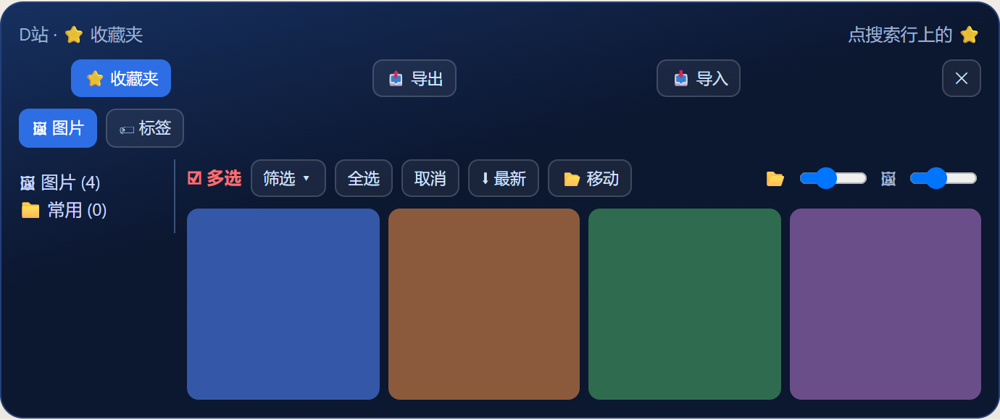
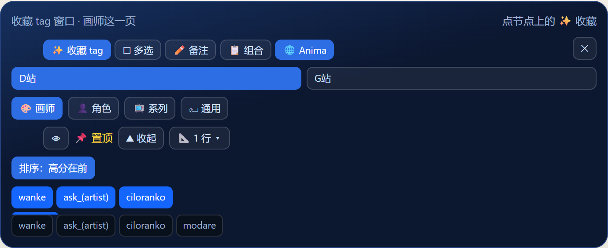

<p align="center">
  
</p>

<h1 align="center">ComfyUI-Danbooru-Anima-Prompt</h1>

<p align="center">在 ComfyUI 里翻 D 站、G 站，把标签写成 Anima、Noob、Aesthetic、NewBie 的提示词。图进 output 之后，顶栏可以打开查看器。</p>

<p align="center">两个创作器在右键菜单 <b>Anima</b>。其余节点在 <b>Danbooru Anima</b>。查看器和总设置在顶栏。总设置的按钮就是上面这枚图标。</p>

<p align="center">
  <a href="#写提示词">写提示词</a> ·
  <a href="#找图">找图</a> ·
  <a href="#改文字">改文字</a> ·
  <a href="#出图之后">出图之后</a> ·
  <a href="#工作流零件">工作流零件</a>
</p>

## 写提示词

### 提示词创作器

`Anima`。按栏写提示词，模型在 Anima、Noob、Aesthetic 之间换。预览那一条接到采样器。


### NewBie 提示词创作器

`Anima`。一个角色一块，出来是 NewBie 用的 XML。


### 随机提示词

按角色抽一条。不顺眼就锁住，只重抽一栏。


### 提示词组合器

把已经拆开的几路标签，按 Anima、Noob、CKNoob、Aesthetic 拼回一条。

### 画师选择

常用画师点一下就进这次的提示词，顺序可以拖。


## 找图

### D站浏览器

在节点里翻 Danbooru。选中的图和拆好的标签接到后面。搜索可以存成书签。


收藏夹单独记，能建文件夹、导出。



### G站浏览器

在 Gelbooru 上搜图。分级最后一档显示为深度。书签和 D 站各记各的。


### AnimaDex 浏览器

查画师、角色和系列，再交到 D 站或 G 站去搜。


### 标签分类器

一整串标签贴进来，拆成角色、画师、服装、姿势这些路。

### 标签映射器

没分上的词指定一个类别，下次分类就记住。

## 改文字

### 文本（透传）

上游的字和节点里写的可以换着用。跑到这里能先停住，改完再继续。


点「收藏」打开的是这扇窗口。画师可以置顶、做成组合。



### 文本（模糊搜索）

能搜标签，芯片和整段文字可以换。藏起来的词不会进后面那句。


### 文本

一段原文，写什么出什么。负面词、固定质量词放这里。

### 文本联结

最多接六段，空的那路跳过。

### 标签预览

把上游的字画在节点上，原样再传下去。

### tag去重

按逗号切开，重复的只留第一次。

## 出图之后

### 输出提示词查看器

顶栏四格图标。按文件夹翻 output，能看提示词、筛选、收藏、对比，删图进系统回收站。


### 顶栏总设置

备份、翻译、G 站凭据、节点主题、弹窗背景。按钮就是页首那枚图标。


## 工作流零件

### 分辨率选择器

输出宽度和高度，接到空潜空间。


### 按宽高比缩放

按最长边或最短边缩到一个长度，原图比例不动。


### 组忽略管理

整组跳过，线还是通的。


### 组禁用管理

整组不跑，线也不通。


账号、API key 和站点登录信息只保存在本机，不要放进公开的压缩包或仓库。

## 开源协议

插件代码采用 [GNU General Public License v3.0](LICENSE)。

随包的外部词表先顶着用，来源如下。自己收集的表换上之后，这些文件会从公开包里拿掉。

- `tags_enhanced.csv`：凉宫秋月的 [DanbooruSearchOnline](https://github.com/SuzumiyaAkizuki/DanbooruSearchOnline)，同样是 GPL-3.0。
- `gelbooru_tags.csv`：来自 [DraconicDragon/Gelbooru-Tags-Full_2026-06-11](https://huggingface.co/datasets/DraconicDragon/Gelbooru-Tags-Full_2026-06-11)。只有英文标签名、分类和帖子数。
- `py/zh_cn/all_tags_cn.json`：临时使用的中文融合词表，来源包括社区既有汉化。
- `py/zh_cn/wai_characters.csv`：来自 [ComfyUI-Danbooru-Gallery](https://github.com/Aaalice233/ComfyUI-Danbooru-Gallery) 的角色名，该仓库为 MIT。
- `py/weilin_tags.db`：预设标签弹窗用的第三方词库。来源协议还没核对完，先随包装上，好让安装后能用这个弹窗。

## 安装

ComfyUI 管理器里搜索 **Danbooru Anima Prompt**。

或在 `ComfyUI/custom_nodes/` 下执行：

```
git clone https://github.com/Zove-try/ComfyUI-Danbooru-Anima-Prompt.git
```

也可以下载压缩包解压到 ComfyUI 的 `custom_nodes/` 目录下：

1. 下载 `ComfyUI-Danbooru-Anima-Prompt.zip`
2. 解压到 `ComfyUI/custom_nodes/` 目录
3. 确认目录结构为 `ComfyUI/custom_nodes/ComfyUI-Danbooru-Anima-Prompt/`
4. 重启 ComfyUI

> 如遇到依赖缺失，在插件目录下运行：`pip install -r requirements.txt`

## 依赖

- `requests`
- `Pillow`
- `torch`
- `numpy`

（这些通常 ComfyUI 已自带）

## 可选：E5-Small 语义搜索引擎（🧠 按钮）

Danbooru Browser 搜索栏的 🧠 按钮启用 **E5-Small 语义搜索**，输入中文/英文描述即可匹配语义相近的 Danbooru 标签（如搜"红头发女孩"命中 `red_hair` + `1girl`）。

> 需要额外安装依赖：`pip install sentence-transformers pandas safetensors`（已在 requirements.txt 中，GitHub 安装会自动装）

### 首次使用（自动下载）

点 🧠 按钮后，插件会在后台自动从 HuggingFace 下载 E5-Small 模型（~470MB），然后对所有标签预计算 embedding 缓存（~280MB），总耗时约 30 秒-1 分钟，**只在首次执行**。后续启动直接加载缓存，< 2 秒。

完成后在 ComfyUI 控制台可看到：
```
[vec_search] E5-Small 引擎初始化完成
```

### 网络不好的用户：手动下载模型

如果自动下载太慢或经常中断，可以手动下载模型后直接放入插件目录：

**步骤：**

1. 从 https://huggingface.co/intfloat/e5-small 下载模型文件
   （需要 `model.safetensors`、`config.json`、`tokenizer.json`、`modules.json` 等）

2. 放入以下目录（已存在，直接放文件就行）：

   ```
   ComfyUI/custom_nodes/ComfyUI-Danbooru-Anima-Prompt/
     py/
       models/
         e5-small/              ← 目录已有，放文件进去
           model.safetensors  ← 放入下载的文件
           config.json
           tokenizer.json
           modules.json
           ...
   ```

3. 重启 ComfyUI，控制台应输出：
   ```
   [E5-Small] 使用本地模型: ...\\py\\models\\e5-small
   ```

> 不需要建目录、不需要设环境变量，文件放对位置就行。

### 删除重建 embedding 缓存

如果 embedding 缓存损坏或想换模型版本，删除以下目录即可，插件重启后会自动重建：

```
ComfyUI-Danbooru-Anima-Prompt/py/tags_embedding/
```

### 一键安装依赖

```bash
cd ComfyUI/custom_nodes/ComfyUI-Danbooru-Anima-Prompt
pip install -r requirements.txt
```

## 可选：本地标签数据库（加速分类）

Tag Classifier 节点默认通过 Danbooru API 在线查询标签分类。
如果下载本地标签数据库，大部分标签将直接在本地查表，无需 API 请求，**速度更快、无需联网、无频率限制**。

### 下载方式

```bash
# 进入插件目录
cd ComfyUI/custom_nodes/ComfyUI-Danbooru-Anima-Prompt

# 下载 tags_enhanced.csv（来自 DanbooruSearchOnline 项目）
curl -L -o tags_enhanced.csv "https://raw.githubusercontent.com/SuzumiyaAkizuki/DanbooruSearchOnline/main/origin_database/tags_enhanced.csv"
```

或手动从 [DanbooruSearchOnline](https://github.com/SuzumiyaAkizuki/DanbooruSearchOnline/blob/main/origin_database/tags_enhanced.csv) 下载后放到插件根目录。

### 使用

下载后重启 ComfyUI，Tag Classifier 节点的「启用本地标签数据库」默认开启。本地查不到的标签会自动 fallback 到 API 查询。

如需关闭，在节点上将开关设为 `False` 即可。
