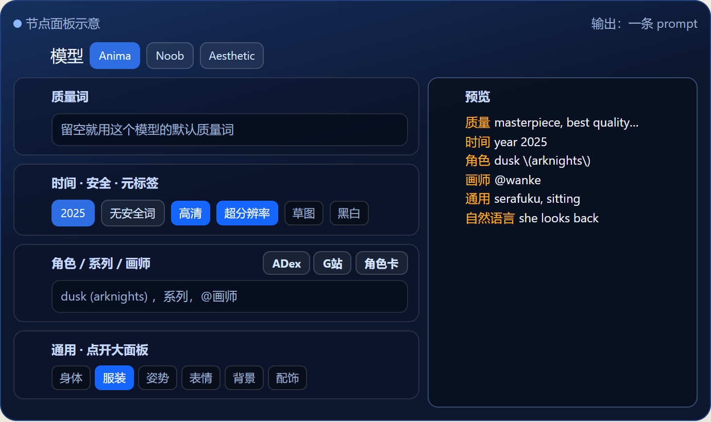
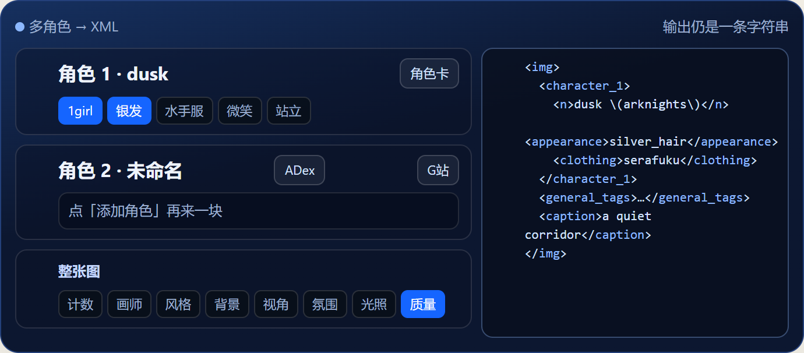
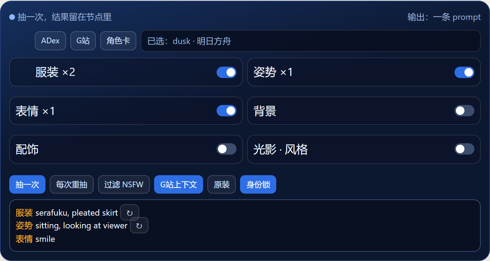
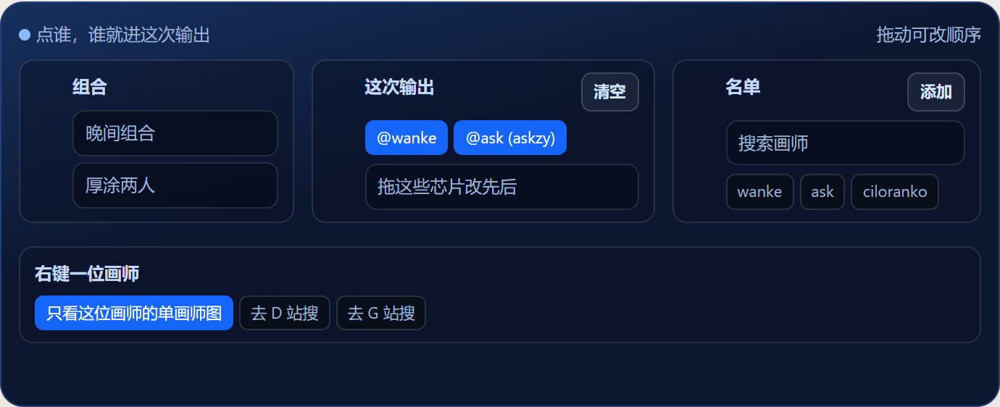
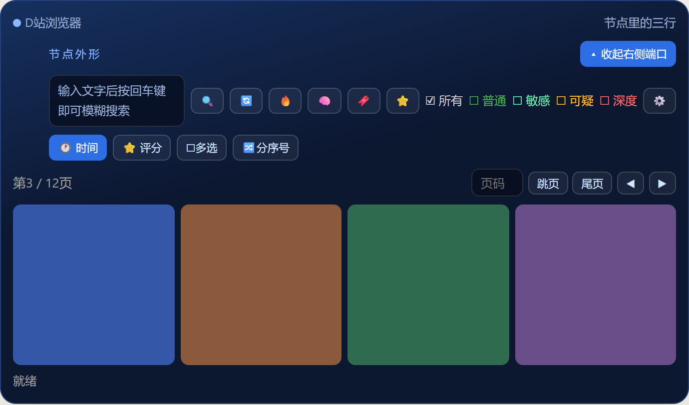
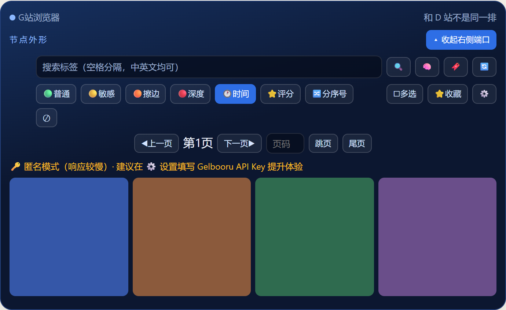
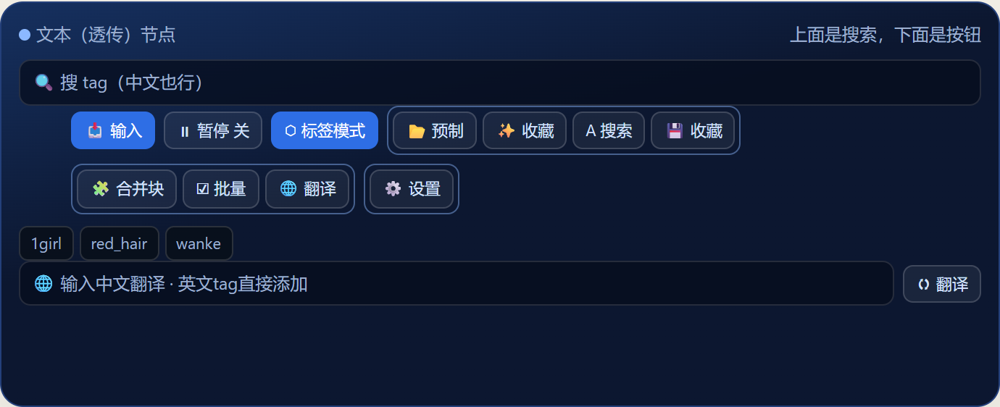
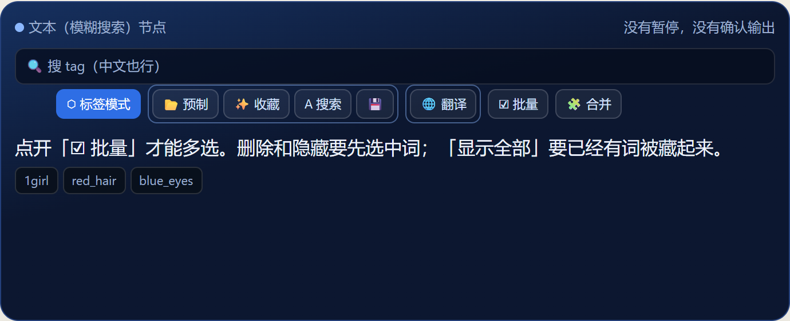
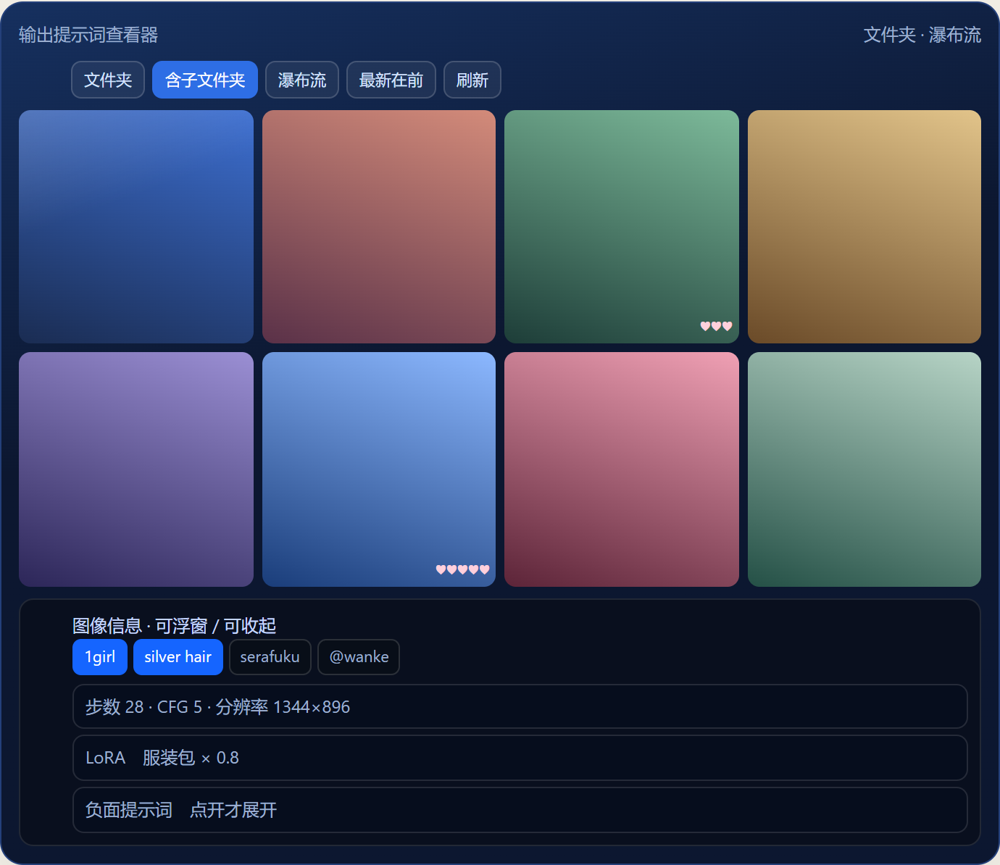
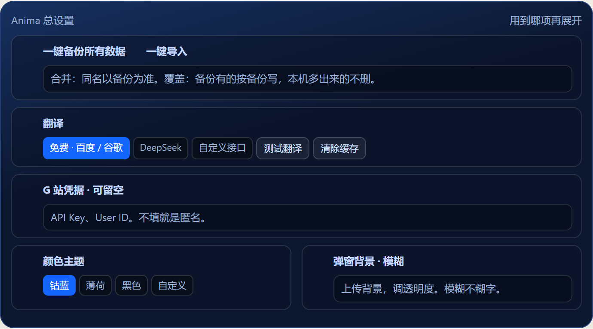

<p align="center">
  
</p>

<h1 align="center">ComfyUI-Danbooru-Anima-Prompt</h1>

<p align="center">本插件在 ComfyUI 里，通过各种自定义节点，输出符合主流二次元模型要求的格式和顺序的提示词。同时本插件自带管理生成图像的工具和一些便携提示词撰写工具。希望大家能喜欢。</p>

<p align="center">
  <a href="#提示词创作">提示词创作</a> ·
  <a href="#搜图和标签">搜图和标签</a> ·
  <a href="#改提示词">改提示词</a> ·
  <a href="#生成图像管理">生成图像管理</a> ·
  <a href="#分辨率和分组">分辨率和分组</a>
</p>

## 提示词创作

### 提示词创作器

正如其名，本节点支持标签自选，选完之后可根据需要用到的提示词格式选择 Anima、Noob、Aesthetic 这三种模式中的一种，来获得相对应的提示词格式。



### NewBie 提示词创作器

与提示词创作器类似，但专为 NewBie 模型 XML 提示词设计，可输出符合 NewBie 模型的 XML 格式提示词。



### 随机提示词

正如其名，该节点用于提示词抽卡。



### 提示词组合器

该节点可以配合 D 站浏览器以及 G 站浏览器，接收其输出的对应种类的标签，然后将接收到的标签根据所选模式，输出符合所选模式格式的提示词。当然也可以连接标签分类器，配合本地反推出来的标签内容来输出对应格式的提示词。

### 画师选择

该节点正如其名，专注于画师选择和组合，可添加常用画师在底部，添加方式不限于 D 站节点收藏或 AnimaDex 节点中的画师和收藏。选择添加进来的画师后，即可添加到输出栏。

被添加到输出栏中的画师可自由拖拽改变顺序，输出栏中画师的顺序就决定了输出画师最后的标签顺序。

同时支持一键输入画师串和画师串管理。



## 搜图和标签

### D站浏览器

该节点灵感来自于 [D站画廊](https://github.com/Aaalice233/ComfyUI-Danbooru-Gallery)，并根据个人使用习惯添加了大量功能。与早期版本相比，UI大幅改进，功能极大丰富。自带图片以及标签收藏功能（这里收藏的画师标签，可在画师选择节点中进行使用），且收藏的图片支持分类以及筛选。



### G站浏览器

与 D 站浏览器类似，适配 Gelbooru 的版本，功能与 D 站浏览器完全对齐。



### AnimaDex 浏览器

使用 AnimaDex 网站自带的画师和角色数据，为用户撰写提示词提供帮助，同时也可以与 D 站浏览器或 G 站浏览器产生联动。


### 标签分类器

标签分类器一般用作对本地反推出来的标签内容进行分类，再将分类出来的内容连接到提示词组合器，最后得到所选模式的提示词。

### 标签映射器

一般用于未分类提示词的手动分类。手动分类保存之后，下次遇到相同的标签，标签分类器会将其分类到对应的种类。

## 改提示词

### 文本（透传）

文本透传节点可以当做提示词中转节点。

当输入模式与暂停模式一起开启时，当前面的提示词内容输入到这个节点时，会自动在这个节点暂停，并出现“确认输出”的按钮。这时必须由用户手动点击“确认输出”，才会将该节点中的内容输出到后续的节点中。这也是这个节点最常用的方式。当然也可以当做一个提示词撰写节点，前提是把输入模式改成内容模式。

这时候，这个节点就会直接忽略前面输入的内容，而直接使用当前节点中的内容进行输出。



### 文本（模糊搜索）

文本模糊搜索节点可以看作开启内容模式的文本透传节点，且不具备暂停功能。



### 文本

跟别的文本节点一样。写一段，原样输出。

### 文本联结

将多段文本连接起来，有多种分隔符可选。

### 标签预览

顾名思义，更适配于预览标签内容的预览节点。

### tag去重

同一句里重复的标签，只留最先出现的那一次。

## 生成图像管理

### 输出提示词查看器

管生成出来的图，尤其是这套按标签出的。可以按角色、画师、模型、标签来筛。图里的画师串也能存下来，存过的会出现在画师选择里，下次直接点。



### 顶栏总设置

备份、翻译、G 站 Key、节点配色、弹窗背景都在这里。顶栏按钮就是页首那张图。



## 分辨率和分组

### 分辨率选择器

选出图用的宽和高，接到空潜空间。


### 按宽高比缩放

把最长边或最短边缩到你填的像素，比例不变。


### 组忽略管理

这一组这次先别跑，后面还得用它前面的结果，就开忽略。这组跳过，线还是通的。


### 组禁用管理

这一组这次彻底不跑，结果也不往下传。后面还连着它的话，这条就断了。


账号、API key 和站点登录信息只保存在本机，不要放进公开的压缩包或仓库。

## 开源协议

插件代码采用 [GNU General Public License v3.0](LICENSE)。

随包的外部词表先顶着用，来源如下。自己收集的表换上之后，这些文件会从公开包里拿掉。

- `tags_enhanced.csv`：凉宫秋月的 [DanbooruSearchOnline](https://github.com/SuzumiyaAkizuki/DanbooruSearchOnline)，同样是 GPL-3.0。
- `gelbooru_tags.csv`：来自 [DraconicDragon/Gelbooru-Tags-Full_2026-06-11](https://huggingface.co/datasets/DraconicDragon/Gelbooru-Tags-Full_2026-06-11)。只有英文标签名、分类和帖子数。
- `py/zh_cn/all_tags_cn.json`：临时使用的中文融合词表，来源包括社区既有汉化。
- `py/zh_cn/wai_characters.csv`：来自 [ComfyUI-Danbooru-Gallery](https://github.com/Aaalice233/ComfyUI-Danbooru-Gallery) 的角色名，该仓库为 MIT。
- `py/weilin_tags.db`：预设标签弹窗用的第三方词库。来源协议还没核对完，先随包装上，好让安装后能用这个弹窗。

## 安装

ComfyUI 管理器里搜索 **Danbooru Anima Prompt**。

或在 `ComfyUI/custom_nodes/` 下执行：

```
git clone https://github.com/Zove-try/ComfyUI-Danbooru-Anima-Prompt.git
```

也可以下载压缩包解压到 ComfyUI 的 `custom_nodes/` 目录下：

1. 下载 `ComfyUI-Danbooru-Anima-Prompt.zip`
2. 解压到 `ComfyUI/custom_nodes/` 目录
3. 确认目录结构为 `ComfyUI/custom_nodes/ComfyUI-Danbooru-Anima-Prompt/`
4. 重启 ComfyUI

> 如遇到依赖缺失，在插件目录下运行：`pip install -r requirements.txt`

## 依赖

- `requests`
- `Pillow`
- `torch`
- `numpy`

（这些通常 ComfyUI 已自带）

## 可选：E5-Small 语义搜索引擎（🧠 按钮）

Danbooru Browser 搜索栏的 🧠 按钮启用 **E5-Small 语义搜索**，输入中文/英文描述即可匹配语义相近的 Danbooru 标签（如搜"红头发女孩"命中 `red_hair` + `1girl`）。

> 需要额外安装依赖：`pip install sentence-transformers pandas safetensors`（已在 requirements.txt 中，GitHub 安装会自动装）

### 首次使用（自动下载）

点 🧠 按钮后，插件会在后台自动从 HuggingFace 下载 E5-Small 模型（~470MB），然后对所有标签预计算 embedding 缓存（~280MB），总耗时约 30 秒-1 分钟，**只在首次执行**。后续启动直接加载缓存，< 2 秒。

完成后在 ComfyUI 控制台可看到：
```
[vec_search] E5-Small 引擎初始化完成
```

### 网络不好的用户：手动下载模型

如果自动下载太慢或经常中断，可以手动下载模型后直接放入插件目录：

**步骤：**

1. 从 https://huggingface.co/intfloat/e5-small 下载模型文件
   （需要 `model.safetensors`、`config.json`、`tokenizer.json`、`modules.json` 等）

2. 放入以下目录（已存在，直接放文件就行）：

   ```
   ComfyUI/custom_nodes/ComfyUI-Danbooru-Anima-Prompt/
     py/
       models/
         e5-small/              ← 目录已有，放文件进去
           model.safetensors  ← 放入下载的文件
           config.json
           tokenizer.json
           modules.json
           ...
   ```

3. 重启 ComfyUI，控制台应输出：
   ```
   [E5-Small] 使用本地模型: ...\\py\\models\\e5-small
   ```

> 不需要建目录、不需要设环境变量，文件放对位置就行。

### 删除重建 embedding 缓存

如果 embedding 缓存损坏或想换模型版本，删除以下目录即可，插件重启后会自动重建：

```
ComfyUI-Danbooru-Anima-Prompt/py/tags_embedding/
```

### 一键安装依赖

```bash
cd ComfyUI/custom_nodes/ComfyUI-Danbooru-Anima-Prompt
pip install -r requirements.txt
```

## 可选：本地标签数据库（加速分类）

Tag Classifier 节点默认通过 Danbooru API 在线查询标签分类。
如果下载本地标签数据库，大部分标签将直接在本地查表，无需 API 请求，**速度更快、无需联网、无频率限制**。

### 下载方式

```bash
# 进入插件目录
cd ComfyUI/custom_nodes/ComfyUI-Danbooru-Anima-Prompt

# 下载 tags_enhanced.csv（来自 DanbooruSearchOnline 项目）
curl -L -o tags_enhanced.csv "https://raw.githubusercontent.com/SuzumiyaAkizuki/DanbooruSearchOnline/main/origin_database/tags_enhanced.csv"
```

或手动从 [DanbooruSearchOnline](https://github.com/SuzumiyaAkizuki/DanbooruSearchOnline/blob/main/origin_database/tags_enhanced.csv) 下载后放到插件根目录。

### 使用

下载后重启 ComfyUI，Tag Classifier 节点的「启用本地标签数据库」默认开启。本地查不到的标签会自动 fallback 到 API 查询。

如需关闭，在节点上将开关设为 `False` 即可。
